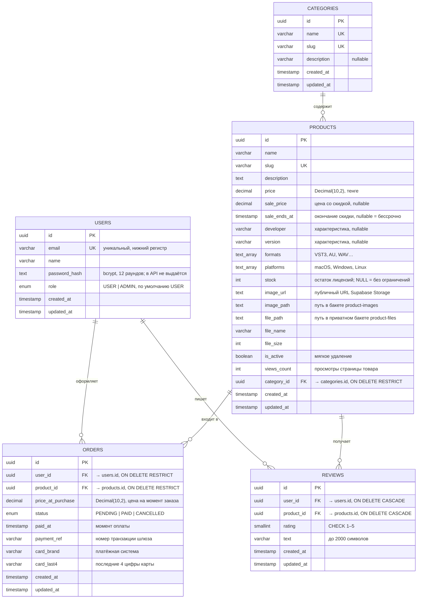

# ER-диаграмма базы данных SYNQ

СУБД — PostgreSQL, схема описана в [`prisma/schema.prisma`](../prisma/schema.prisma), миграция — [`prisma/migrations`](../prisma/migrations).

## Связи

| Связь | Тип | Внешний ключ | Поведение при удалении |
|---|---|---|---|
| `users` → `orders` | 1 : N | `orders.user_id` → `users.id` | `RESTRICT` — история заказов неприкосновенна |
| `categories` → `products` | 1 : N | `products.category_id` → `categories.id` | `RESTRICT` — API возвращает `409 CATEGORY_NOT_EMPTY` |
| `users` → `reviews` | 1 : N | `reviews.user_id` → `users.id` | `CASCADE` |
| `products` → `reviews` | 1 : N | `reviews.product_id` → `products.id` | `CASCADE` |
| `products` → `orders` | 1 : N | `orders.product_id` → `products.id` | `RESTRICT` — товар с заказами архивируется (`is_active = false`) |

## Индексы и ограничения

| Таблица | Индекс / ограничение | Назначение |
|---|---|---|
| `users` | `UNIQUE(email)` | Один аккаунт на email (409 `EMAIL_TAKEN`) |
| `categories` | `UNIQUE(name)`, `UNIQUE(slug)` | Человекочитаемые URL каталога |
| `products` | `UNIQUE(slug)` | Уникальные URL товаров |
| `products` | `INDEX(category_id)` | Выборка товаров категории |
| `products` | `INDEX(is_active, created_at)` | Витрина: активные товары, сортировка «сначала новые» |
| `products` | `INDEX(name)` | Сортировка по названию |
| `orders` | `INDEX(user_id, created_at)` | «Мои заказы» |
| `reviews` | `UNIQUE(user_id, product_id)`, `CHECK(rating BETWEEN 1 AND 5)` | Один отзыв на товар, корректная оценка |
| `reviews` | `INDEX(product_id, created_at)`, `INDEX(rating)` | Отзывы товара, фильтр по оценке |
| `orders` | `INDEX(product_id)`, `INDEX(status)` | Статистика и фильтры админ-панели |

## Почему так

* **Скидки.** `sale_price` действует, пока не наступил `sale_ends_at`; заказ фиксирует действующую цену (со скидкой).
* **Отзывы только от покупателей:** создать отзыв можно при наличии заказа со статусом `PAID`; уникальный индекс не даёт написать второй.
* **«Самое популярное»** считается как `оплаченные заказы × 20 + views_count`.
* **Цена фиксируется в заказе** (`price_at_purchase`): изменение цены товара не меняет уже оформленные заказы и выручку.
* **Мягкое удаление товара.** Если по товару есть заказы, `DELETE /api/products/:id` переводит его в архив: из витрины он исчезает, а покупатели сохраняют доступ к скачиванию.
* **Остатки (`stock`)** — число доступных лицензий. Резервирование при заказе выполняется атомарным условным `UPDATE … WHERE stock > 0`, отмена заказа возвращает лицензию.
* **Характеристики** цифрового товара (разработчик, версия, форматы, платформы) хранятся в самой таблице `products`: набор полей фиксирован и используется для фильтрации (`platform`).
